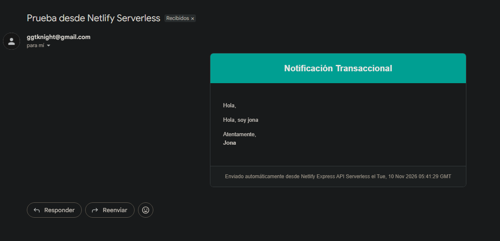
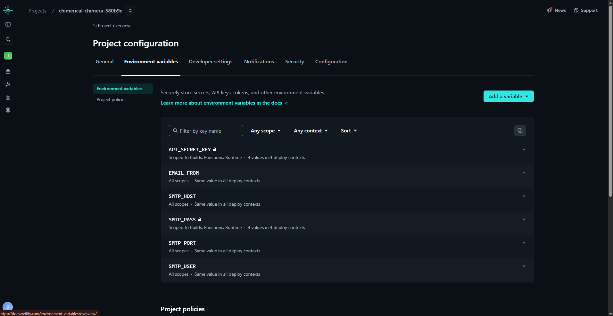

 # 1. Cold Start
 El Cold Start (arranque en frío) es el fenómeno que se produce en arquitecturas *serverless* al invocar una función sin un contenedor de ejecución activo. En ese caso, la plataforma tiene que preparar un entorno nuevo, descargar el código, instalar o cargar las dependencias (el entorno de ejecución de Node. js) y correr el script inicial.

 En una API desarrollada con Express, esto perjudica la latencia de la primera petición (o de una petición posterior a un periodo de inactividad), pues el tiempo de respuesta aumenta considerablemente (de cientos de milisegundos a varios segundos) por el peso del *runtime* de Node. js y la cantidad de módulos importados.

 ---

 # 2. Estado Efímero (Statelessness)
 Por naturaleza, las funciones *serverless* son sin estado (stateless) y tienen un ciclo de vida breve.

 Al declarar en `api. js` una variable global como `let contador = 0;`:
 • Escalado Horizontal: Las peticiones concurrentes se repartirán entre varias instancias independientes de la función, cada una con su propia copia aislada de `contador`.
 • Destrucción de Instancias: Las instancias se generan y eliminan automáticamente en función de la demanda, por lo que al apagarse se pierde todo el estado almacenado en memoria.

 Por estos motivos, el valor de la variable resulta impredecible y no se debe utilizar para guardar información, como un contador de visitas en producción. Para ello, es necesario recurrir a bases de datos externas o a servicios de almacenamiento en caché, como Redis.

 ---

 # 3. Patrón Adapter y `serverless-http`
 Express fue concebido para funcionar en un servidor HTTP persistente (Node. js tradicional), que permanece escuchando en un puerto determinado mediante un socket TCP y gestiona objetos nativos de Node. js (`http. IncomingMessage` y `http. ServerResponse`). En cambio, plataformas como AWS Lambda o Netlify ejecutan funciones mediante un evento JSON puntual y un objeto de contexto.

 El paquete `serverless-http` aplica el Patrón Adapter: sirve de intermediario y transforma el evento JSON que recibe del entorno serverless en objetos de solicitud/respuesta compatibles con Express. Después de que Express atiende la petición, `serverless-http` transforma su respuesta al formato de retorno JSON estructurado que necesita la plataforma serverless.

 ---

 # 4. Principios de 12-Factor App y Seguridad
 Publicar un archivo `. env` en un repositorio público de GitHub constituye una falla crítica de seguridad, ya que deja expuesta información sensible e irrecuperable (claves de API, credenciales de base de datos, tokens de acceso o llaves secretas) ante cualquier usuario o bot automatizado que rastree la red con el fin de explotar esas credenciales.

 De acuerdo con la metodología 12-Factor App (Factor III: Configuración), los datos de configuración que cambian entre despliegues deben mantenerse estrictamente separados del código fuente.

 Netlify (y otras plataformas cloud) evita este riesgo al permitir la inyección de variables de entorno de manera cifrada directamente en el entorno de ejecución de la plataforma, mediante su panel de administración o CLI. Así, el código fuente consulta `process. env` durante la ejecución sin que sea necesario cargar archivos secretos al control de versiones.

 ---

 # 5. Riesgo de Open Relay y Abuso
 Dejar expuesto un endpoint HTTP `POST` para enviar correos sin autenticación, captcha ni limitación de tasa (*rate limiting*) somete al servidor a los siguientes riesgos:

 • Consecuencias Técnicas:
 • Agotamiento de Recursos y Cuotas: Exposición a ataques de denegación de servicio (DoS), capaces de consumir rápidamente las cuotas de envío del proveedor SMTP o de ocasionar costos económicos elevados.
 • Spam Relay: Envío masivo de correo no deseado a terceros mediante el uso de la infraestructura del servidor.
 • Reputación de Dominio:
 • Listas Negras (Blacklisting): Las direcciones IP y el dominio de envío quedarán marcados e incluidos en listas de spam (RBLs como Spamhaus).
 • Pérdida de Entregabilidad: Los mensajes legítimos enviados desde ese dominio serán rechazados o llegarán directamente a la carpeta de *Spam/Junk* en proveedores como Gmail, Outlook o Yahoo.